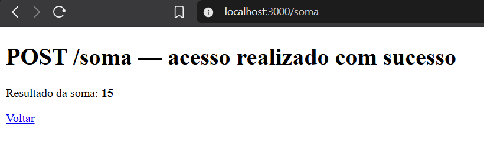

# Formulário de soma com GET e POST (Node.js + Express)

> 📦 **Repositório arquivado.** A versão ampliada deste exercício, com soma, subtração, multiplicação, divisão e respostas em JSON, está em **[site-soma](https://github.com/Eujorgyn/site-soma)**.

Servidor **Express** com duas rotas:

- **GET `/`**: mostra um formulário com dois números;
- **POST `/soma`**: recebe os valores, valida (retorna erro 400 se a entrada for inválida) e mostra o resultado.

## Como executar

```bash
npm install
node servidor.js
```

Depois é só acessar `http://localhost:3000`.



## Autor

**Jorge Gabriel**, estudante de Análise e Desenvolvimento de Sistemas na UNIFOR.
